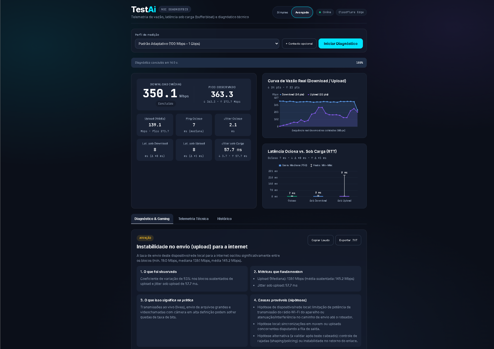

# TestAi — Diagnóstico Inteligente de Conexão e Hardware

> **Produção (Live Demo):** [https://testai-speedtest.vercel.app](https://testai-speedtest.vercel.app)


-60A5FA)

Aplicação web de diagnóstico de rede, Looking Glass TCP e análise comparativa de capacidade Wi-Fi/hardware de dispositivos. Projetada com **zero dependências de runtime**, **zero `innerHTML` / `outerHTML` / `insertAdjacentHTML`** (DOM 100% seguro via `createElement`, `createElementNS` e `textContent`), backend opcional em Node.js puro em RAM e **123 testes automatizados** em **14 suítes** (`node:test`).

---

## Interface (Modo Simples e Modo Avançado)

### Modo Simples — Diagnóstico Direto, Selos de Uso, Histórico Comparativo e Dispositivo


### Modo Avançado / NOC (Parte 1) — Telemetria em Tempo Real e Latência sob Carga


### Modo Avançado / NOC (Parte 2) — Diagnóstico Técnico, Rota/Jogos e Comparativo de Hardware


---

## 1. Recursos Atuais

- **Estatística Canônica Única + Blocos Adaptativos para Fibra:** configurado por padrão em [`public/config.json`](./public/config.json) com `"measurementMode": "commercial"` (**P90** após descarte do aquecimento inicial *TCP Slow Start* de `1000 ms`, `parallelStreams: { download: 6, upload: 4 }`), escalando blocos HTTP de download até **50 MB** em links de fibra rápida enquanto preserva blocos menores em conexões móveis/lentas. As estatísticas consolidadas (`result.stats.download` e `result.stats.upload`, incluindo `P50`, média e `CV`) também operam exclusivamente sobre os pontos pós-aquecimento, preservando a curva completa em `result.series.*` apenas para visualização gráfica.
- **Selo Visual de Rota (`On-Net` vs `Off-Net`) e Precisão Sub-milissegundo:** identifica automaticamente a rota ativa em `runtime-config.js` e confirma via cabeçalho `X-TestAi-Route: on-net` + `Server-Timing: app;dur=<ms>` em `/api/ping`, exibindo `Servidor Local • <ISP>` (tom positivo) ou `Rota Externa • Cloudflare` (tom de aviso) tanto na interface principal quanto no Modo Widget (`?embed=1`), preservando RTTs On-Net sub-milissegundo (`>= 0.05 ms`).
- **Spike Guard, Perda de Sondas e 4 Classificadores Alinhados (`src/diagnostics/stability-rules.js`):** fonte única de verdade compartilhada por `capability-advisor.js`, `connection-diagnostics.js`, `usage-verdict.js` e `gaming-analyzer.js`. Picos isolados leves (`+80..249 ms`) mantêm nota informativa, mas **picos isolados severos (`>= +250 ms` acima do ping em repouso) nunca recebem `"Excelente"`**, rebaixando a estabilidade com subtítulo explícito da causa. Timeouts e perdas de sondas (`latencyProbes.lossPct >= 10%` ou `>= 2` timeouts sob carga) também rebaixam a classificação (eliminando viés de sobrevivência), enquanto `computeJitterMs` aplica poda robusta contra 1 único outlier isolado (`N >= 6`).
- **Proteção contra Pool HTTP/1.1 e Monotonicidade no Upload:** detecta `PerformanceResourceTiming.nextHopProtocol` no warmup e limita automaticamente a concorrência em **4 streams** quando o servidor responde em `http/1.1` (evitando fila nos 6 sockets por origem do navegador). No upload multi-stream XHR, `createUploadByteTracker` soma continuamente `confirmedBytes + inFlightBytes` com transferência atômica sem degraus nem congelamento.
- **Hierarquia Visual em 3 Níveis e Divulgação Progressiva (Modo Simples):** mantém sempre visíveis na primeira dobra pós-teste o medidor principal (Nível 1), o veredito simplificado humanizado e o bloco **"Pronto para o seu dia a dia?"** (Nível 2), recolhendo os 2 blocos utilitários secundários em painéis `<details>` / `<summary>` nativos fechados por padrão (*Histórico recente* e *Consulte seu dispositivo* — Nível 3).
- **Histórico Local Unificado (`schemaVersion: 2`):** Modo Simples (visão dos últimos 10 testes) e Modo Avançado (até 100 registros) compartilham a mesma base canônica em `localStorage` (`testai_history_v2`), com migração transparente de registros legados `v1`/`v2`, limpeza sincronizada e exportação JSON/CSV completa (`routeType`, `serverLabel`, `measurementMode`, vazão sustentada, picos, perda de sondas e estabilidade).
- **PWA Instalável Sem Cache de Medição:** [`public/manifest.webmanifest`](./public/manifest.webmanifest) + [`public/sw.js`](./public/sw.js) com estratégia **Network-First** restrita ao App Shell e *bypass* estrito para `/api/*`, `/config.json`, domínios externos e requisições `POST`.
- **Compartilhamento e Laudo Dinâmico Prontos para Suporte:** gera card PNG `1080×1080` via Canvas 2D nativo (`src/services/share-card.js`), resumo copiável em 1 clique (`#copySummaryBtn`) e laudo `.TXT` (`history.storage.js`) identificando fielmente `Servidor Local (On-Net)` vs `Cloudflare Edge (Off-Net)`, picos severos e perdas de sondas.
- **Blindagem Operacional do Servidor On-Net (`server/index.js`):** controle configurável de fluxos simultâneos por IP (`MAX_STREAMS_PER_IP=8` → `HTTP 429`) e global do nó (`MAX_GLOBAL_STREAMS=64` → `HTTP 503`) com liberação imediata em conexões abortadas, `resolveClientIp` protegido por `TRUST_PROXY`, Looking Glass TCP Anti-SSRF e métricas Prometheus `GET /metrics`.

---

## 2. Como Funciona o Motor e o Diagnóstico

### 2.1 Configuração Dinâmica (`public/config.json`), Boot Seguro e Rotas
- **Boot sem condição de corrida (`src/main.js` + `src/services/runtime-config.js`):** os botões de início permanecem bloqueados em estado `Inicializando...` até `loadRuntimeConfig()` resolver (`cache: 'no-store'`, timeout curto de `2500 ms`), expondo explicitamente em `getRuntimeState()` se a sessão operará em rota **`on-net`** (servidor próprio do ISP) ou **`off-net-fallback`** (Cloudflare Edge).
- **Implantação Self-Hosted (ISP On-Net):** [`deploy/entrypoint.sh`](./deploy/entrypoint.sh) gera `/config.json` apontando para `/api/ping`, `/api/down`, `/api/up` e `/api/meta` e injeta a política configurável `ALLOWED_FRAME_ANCESTORS` no Nginx (e via variável de ambiente no [`Caddyfile`](./Caddyfile)).

---

### 2.2 Métricas, Estatística Canônica e Spike Guard

#### Ping Ocioso (RTT Base), Espaçamento e Jitter Robusto
1. Envia **1 sonda de aquecimento** (`bytes=0&during=warmup`, descartada) que estabelece TLS/conexão, detecta `nextHopProtocol` e confirma `X-TestAi-Route`.
2. Executa de **8 a 16 sondagens sequenciais** (`during=idle`) com espaçamento controlado (`~60 ms` entre amostras dentro do `maxBudgetMs`), filtrando o tempo de processamento de servidor via `Server-Timing` (`app;dur=` no backend On-Net ou `cfSpeed*` / `cfL4` na Cloudflare) e consolidando na **mediana (`P50`)**.
3. O **Jitter** aplica poda leve quando `N >= 6` apenas se existir **exatamente 1 amostra anômala isolada**, impedindo que uma pausa única de rádio/GC infle a diferença consecutiva em dobro, enquanto preserva integralmente séries com 2 ou mais oscilações.

#### Download e Upload Multi-Stream, `ΔRTT`, Picos e Perda de Sondas
- Descarta os primeiros `1000 ms` (`rampDiscardMs`) ao consolidar **P90** (`commercial`) ou **P50** (`sustained`) e ao calcular `result.stats.download` / `result.stats.upload`.
- Contabiliza em `result.latencyProbes` (`idle`, `download`, `upload`) `attempts`, `succeeded`, `timeouts`, `failures`, `lossPct`, `maxMs` e `p95Ms`.
- **Regras unificadas (`src/diagnostics/stability-rules.js`):**
  - `Δ >= 60 ms`, `jitter > 20 ms`, `ping > 300 ms` ou `lossPct >= 25%` → **`Sensível`** (`danger`).
  - `Δ >= 30 ms` (em qualquer direção), `jitter > 12 ms`, `ping > 150 ms`, `lossPct >= 10%`, `>= 2` timeouts sob carga, picos recorrentes (`>= 3` amostras ou `>= 25%`) ou **pico isolado severo (`>= +250 ms`)** → **`Moderada`** (`warning`), com subtítulo fiel ao gatilho real.
  - Pico isolado leve (`+80..249 ms`) com demais métricas limpas → **`Excelente`** (`good`) com nota informativa do pico e da fase.

#### Perfis de Medição (`src/config/speedtest.config.js`)

| Perfil | Fluxos Base (↓ / ↑) | Duração por Fase | Pings Ociosos | Teto por Bloco (↓ / ↑) | Indicação |
| :--- | :--- | :--- | :--- | :--- | :--- |
| `light` (Econômico / Móvel) | `3 ↓ / 3 ↑` | `4,5 s` | `8` | `10 MB / 2 MB` | Redes móveis 4G/5G ou triagem rápida |
| `standard` (Padrão Adaptativo) | `4 ↓ / 4 ↑` | `6,5 s` | `10` | `25 MB / 4 MB` | Links residenciais/corporativos de 100 Mbps a 1 Gbps |
| `multigig` (Alta Capacidade) | `6 ↓ / 4 ↑` | `8,0 s` | `10` | `50 MB / 5 MB` | Saturação de planos Gigabit e Multi-Gigabit |
| `stability` (Bufferbloat) | `4 ↓ / 4 ↑` | `9,0 s` | `16` | `25 MB / 4 MB` | Investigação prolongada de estabilidade e *bufferbloat* |

*(Em `"measurementMode": "commercial"`, a concorrência segue `parallelStreams` de [`public/config.json`](./public/config.json): padrão `6 ↓ / 4 ↑`, com redução automática para `4 ↓ / 4 ↑` caso o servidor responda em `http/1.1`.)*

---

## 3. Como Incorporar em Provedores (Modo Widget `?embed=1`)

> **Atenção para Provedores (ISPs):** **NÃO incorpore a URL da Demo Pública (`testai-speedtest.vercel.app`) no site oficial ou na Central do Assinante do provedor.** A demo pública mede a rota externa até a Cloudflare (*Off-Net*), exibindo o aviso `Rota Externa • Cloudflare`, e está sujeita a congestionamento de trânsito/peering fora da sua rede. Para aferir a entrega real da sua última milha/BNG com selo `Servidor Local • <Seu ISP>`, hospede a instância no seu próprio POP.

### Comparativo: Produção Auto-hospedada (On-Net) vs. Demo Pública (Off-Net)

| Critério | Produção Auto-hospedada (`Cliente ↔ ISP / On-Net`) | Demo Pública (`Cliente ↔ Cloudflare / Off-Net`) |
| :--- | :--- | :--- |
| **Percurso medido** | Última milha óptica/rádio direto até o POP/BNG do provedor (`/api/*`) | Rede do assinante + trânsito/IX externo até Anycast da Cloudflare |
| **Selo exibido na UI / Widget** | `Servidor Local • <Nome do Provedor>` (tom positivo) | `Rota Externa • Cloudflare` (tom de aviso) |
| **Precisão de Ping Ocioso** | Sub-milissegundo real (`>= 0,05 ms`) com `Server-Timing: app;dur` | Dependente da distância geográfica e roteamento BGP até a borda |
| **Looking Glass TCP (`/api/looking-glass`)** | Habilitado a partir do servidor do provedor | Indisponível (somente frontend estático) |
| **Controle de `frame-ancestors` (iframe)** | Restrito aos domínios oficiais do ISP via `ALLOWED_FRAME_ANCESTORS` | Aberto apenas para demonstração e homologação visual |
| **Uso recomendado** | **Site institucional, Central do Assinante e suporte técnico (NOC)** | Avaliação rápida da interface antes de implantar |

### Fluxo de Implantação do Widget em 3 Passos (ISP)

1. **Apontamento DNS (`A` / `AAAA`):** crie um subdomínio dedicado (ex.: `velocidade.seuprovedor.com.br`) apontando para o IPv4 e IPv6 públicos da máquina/VM de medição conectada em 1G/10G+ no seu POP/BNG.
2. **Subida Docker + Caddy/Nginx com `ALLOWED_FRAME_ANCESTORS`:** configure o `.env` autorizando os domínios que poderão abrir o `<iframe>` e suba os containers com TLS/HTTP2:
   ```env
   ISP_NAME="FibraSul Telecom"
   SERVER_LABEL="POP Matriz 10G"
   DOMAIN="velocidade.seuprovedor.com.br"
   TRUST_PROXY=true
   ALLOWED_FRAME_ANCESTORS="'self' https://www.seuprovedor.com.br https://central.seuprovedor.com.br"
   ```
   ```bash
   docker compose -f docker-compose.yml -f docker-compose.caddy.yml up -d --build
   ```
3. **Incorporação `<iframe>` no site ou Central do Assinante:** aponte exclusivamente para o domínio próprio do provedor com `?embed=1`, `allow="clipboard-write"` e `loading="lazy"`:
   ```html
   <iframe
     src="https://velocidade.seuprovedor.com.br/?embed=1"
     title="Teste de Velocidade FibraSul Telecom"
     width="100%"
     height="600"
     loading="lazy"
     allow="clipboard-write"
     style="border: 0; border-radius: 16px; overflow: hidden;"
   ></iframe>
   ```

Quando `?embed=1` está ativo (`body.is-embed`), a interface exibe apenas o núcleo compacto (selo discreto de rota On-Net/Off-Net, barra de progresso, velocímetro tabular, resumo de 4 métricas, ações de teste/compartilhamento/cópia, veredito humanizado e os 3 selos práticos de uso), ocultando cabeçalho completo, seletor NOC, barra de plano, painéis `<details>` e rodapé.

---

## 4. Arquitetura Modular

Consulte os contratos detalhados em [`docs/ARCHITECTURE.md`](./docs/ARCHITECTURE.md):

- `public/`: manifesto PWA (`manifest.webmanifest`), ícones (`icons/*.png`), Service Worker (`sw.js`) e configuração em tempo de execução (`config.json`).
- `server/`: backend nativo Node.js em RAM (`index.js`) com controle de concorrência por IP/global e `TRUST_PROXY`, módulo Looking Glass Anti-SSRF (`looking-glass.js`) e expositor Prometheus `GET /metrics` (`metrics.js`).
- `src/config/`: perfis de medição (`TEST_PROFILES`) e limiares de diagnóstico/gaming.
- `src/diagnostics/`: regras compartilhadas de estabilidade, *Spike Guard* e perda de sondas (`stability-rules.js`), diagnóstico multidimensional (`connection-diagnostics.js`), gaming (`gaming-analyzer.js`) e estabilidade/capacidades (`capability-advisor.js`).
- `src/services/` e `src/storage/`: motor multi-stream (`speedtest.service.js`), `runtime-config.js`, PWA (`pwa.js`), card Canvas (`share-card.js`), selos de uso (`usage-verdict.js`), histórico unificado `schemaVersion: 2` (`history.storage.js` + `history.service.js`), cliente Looking Glass (`looking-glass.service.js`) e lookup de dispositivos (`device-specs.service.js`).
- `src/ui/` e `src/main.js`: módulos seguros de interface (`telemetry-view.js`, `simple-view.js`, `insights-view.js`, `diagnostics-view.js`, `looking-glass-view.js`, `history-view.js`, `device-panel.js` e `icons.js`).
- `src/styles/`: design system modular baseado exclusivamente em tokens em `tokens.css`.
- `tests/`: **14 suítes** cobrindo **123 testes** em Node.js nativo (`node --test tests/*.test.js`).

---

## 5. Como Executar Localmente e em Produção

### Pré-requisitos
- Node.js 18+ e npm (ou Docker Engine + Docker Compose v2 para implantação On-Net).

### Desenvolvimento e Testes
```bash
npm install
npm run dev           # Servidor de desenvolvimento Vite
npm run start:server  # Micro-servidor Node.js de medição + Looking Glass + /metrics (porta 3001)
npm run typecheck     # Verificação estática JSDoc (tsc -p tsconfig.json)
npm test              # Executa todas as 14 suítes (123 testes)
npm run build         # Gera build de produção em dist/
npm run preview       # Pré-visualiza dist/ localmente
```

### Simulador Offline de Perfis (TestAi Lab)
```bash
node scripts/benchmark-profiles.mjs
```

Consulte o guia completo de produção On-Net, tuning **TCP BBR**, proteção de `/metrics` e validação pós-deploy em [**`docs/hospedagem-provedor.md`**](./docs/hospedagem-provedor.md).

---

## Licença
Distribuído sob a licença MIT. Veja [`LICENSE`](./LICENSE).
