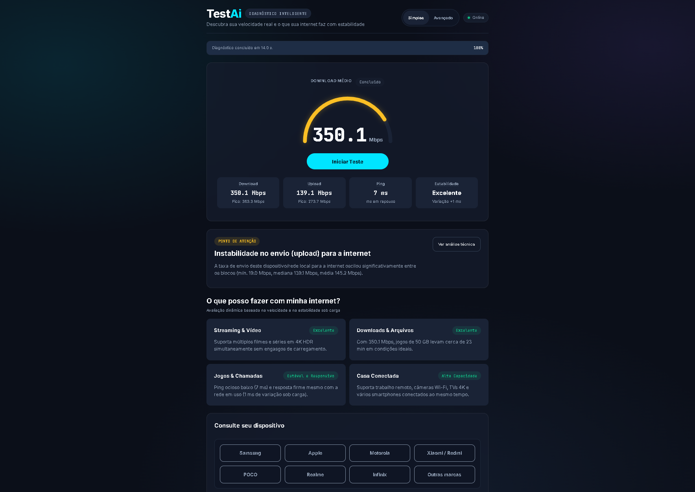
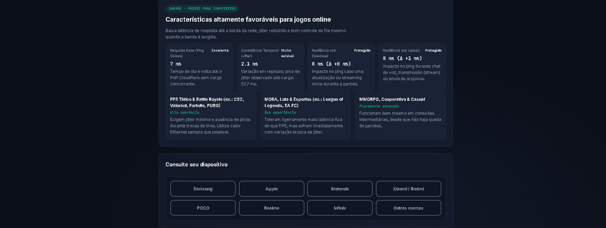

# TestAi — Diagnóstico Inteligente de Conexão e Hardware

> **Produção (Live Demo):** [https://testai-speedtest.vercel.app](https://testai-speedtest.vercel.app)


-60A5FA)

Aplicação web de diagnóstico de rede, Looking Glass TCP e análise comparativa de capacidade Wi-Fi/hardware de dispositivos. Projetada com **zero dependências de runtime**, **zero `innerHTML` / `outerHTML` / `insertAdjacentHTML`** (DOM 100% seguro contra XSS), backend opcional em Node.js puro em RAM e **91 testes automatizados** em 11 suítes.

---

## Interface (Modo Simples e Modo Avançado)

### Modo Simples — Diagnóstico Direto, Selos de Uso, Histórico Comparativo e Dispositivo


### Modo Avançado / NOC (Parte 1) — Telemetria em Tempo Real e Latência sob Carga


### Modo Avançado / NOC (Parte 2) — Diagnóstico Técnico, Rota/Jogos e Comparativo de Hardware


---

## 1. Recursos Atuais

- **Motor Comercial P90 + Blocos Adaptativos para Fibra:** configurado por padrão em [`public/config.json`](./public/config.json) com `"measurementMode": "commercial"` (**P90** após descarte do aquecimento inicial *TCP Slow Start* de `1000 ms`, `parallelStreams: { download: 6, upload: 4 }`), escalando blocos HTTP de download até **50 MB** em links de fibra rápida enquanto preserva blocos menores em conexões móveis/lentas. Mantém suporte completo ao modo `"sustained"` (**P50 / média sustentada**) e preserva os gráficos completos, P50, pico, ping, jitter e $\Delta\text{RTT}$ no Modo Avançado/NOC.
- **PWA Instalável Sem Cache de Medição:** [`public/manifest.webmanifest`](./public/manifest.webmanifest) + [`public/sw.js`](./public/sw.js) com estratégia **Network-First** restrita ao App Shell (`/`, `/index.html`, `/assets/*`, `/icons/*`, `/manifest.webmanifest`) e *bypass* estrito para `/api/*`, `/config.json`, domínios externos (como `speed.cloudflare.com`) e requisições não-`GET` (`POST`).
- **Compartilhamento Pronto para Suporte:** gera um card visual PNG `1080×1080` via Canvas 2D nativo (`src/services/share-card.js`) com envio direto para WhatsApp/Web Share no celular (e download automático no desktop), além do botão **Copiar Resumo** em 1 clique (`#copySummaryBtn`) com resumo em texto puro e fallback via `<textarea>` + `document.execCommand('copy')` para uso em `iframe`.
- **Histórico Comparativo e Selos de Uso Real:** persiste os últimos **10 testes** no `localStorage` (`testai:history:v1`), exibe o comparativo ($\Delta$) contra o teste imediatamente anterior, exporta em **CSV (RFC 4180)** ou **JSON** e apresenta 3 selos práticos pós-teste: **Jogos FPS**, **Videochamadas** e **Streaming 4K**.
- **Looking Glass Seguro (Modo Avançado → Aba Rota / Jogos):** realiza sondas TCP leves via `GET /api/looking-glass/presets` e `POST /api/looking-glass` com presets oficiais (**Cloudflare DNS**, **Google DNS**, **AWS São Paulo** e **Rota Jogos SP**), trava **Anti-SSRF** (*fail-closed* IPv4/IPv6 + proteção contra *DNS rebinding* conectando no IP validado) e *rate limit* por IP (`HTTP 429`), exibindo fallback discreto quando hospedado apenas em ambiente estático (Vercel).
- **Infraestrutura NOC / Provedor:** overlay opcional **Caddy** ([`docker-compose.caddy.yml`](./docker-compose.caddy.yml) + [`Caddyfile`](./Caddyfile)) com HTTPS automático (Let's Encrypt) e `flush_interval -1` sem compressão em `/api/*`, além do endpoint **`GET /metrics`** em formato Prometheus (`0.0.4`) protegido opcionalmente por `METRICS_TOKEN` validado em tempo constante (`crypto.timingSafeEqual`).

---

## 2. Como Funciona o Motor e o Diagnóstico

### 2.1 Configuração Dinâmica (`public/config.json`) e Servidores
- **Em tempo de execução (`src/services/runtime-config.js`):** carrega `./config.json` com `cache: 'no-store'`.
- **Deploy estático padrão (Vercel):** utiliza `"measurementMode": "commercial"` contra a borda [Cloudflare Edge Anycast](https://speed.cloudflare.com) (`/__down` e `/__up`), com telemetria `Server-Timing` (`cfSpeedEdge`, `cfSpeedWorker`, `cfL4` com `rtt` TCP) e `PerformanceResourceTiming`.
- **Implantação Self-Hosted (ISP On-Net):** substitui os endpoints por `/api/ping`, `/api/down`, `/api/up` e `/api/meta` via `.env`, habilitando também `/api/looking-glass` e `/metrics`. Se `./config.json` falhar ou estiver ausente, o fallback automático garante compatibilidade contínua.

---

### 2.2 Métricas, Modos e Calibração para Fibra

#### Ping Ocioso (RTT Base) e Jitter
1. Envia **1 sonda de aquecimento** (`bytes=0&during=warmup`, descartada) para estabelecer conexão/TLS.
2. Executa de **8 a 16 sondagens sequenciais** (`during=idle`, conforme perfil) filtradas por `resolveNetworkRttMs` (isolando RTT TCP real via `cfL4` contra picos do Worker ou handshake inicial) e consolida na **mediana (`P50`)**.
3. O **Jitter** (ocioso e sob carga) é a média das diferenças absolutas entre amostras consecutivas de RTT:
   $$\text{Jitter} = \frac{1}{N - 1} \sum_{i=1}^{N-1} |\text{RTT}_i - \text{RTT}_{i-1}|$$

#### Download Multi-Stream e Escalonamento Adaptativo
- Executa **3 a 6 fluxos paralelos** (ou até `1..8` conforme `parallelStreams.download`) lendo continuamente em janela deslizante de `1 s` (`250 ms` por tick), com recuperação silenciosa de *stalls* individuais (`2000 ms`) e *downshift* automático em `429`/`403`.
- **Blocos HTTP adaptativos (`computeAdaptiveDownloadChunkBytes`):** mantém blocos leves (`1–2 MB`) abaixo de `50 Mbps` para não travar redes móveis fracas, sobe para `5 MB` até `100 Mbps`, `25 MB` acima de `100 Mbps` e até **50 MB** acima de `300 Mbps` (`SAFE_MAX_DOWNLOAD_CHUNK_BYTES`), respeitando sempre o teto de segurança do perfil e do servidor (`MAX_DOWNLOAD_BYTES`).
- **Aquecimento inicial (*TCP Slow Start*) e modos:** descarta os primeiros `1000 ms` (`rampDiscardMs`) ao consolidar **P90** (modo `commercial`) ou **Média sustentada / P50** (modo `sustained`), preservando integralmente toda a série de pontos para os gráficos, pico e telemetria NOC.

#### Upload Multi-Stream e Latência sob Carga (`ΔRTT`)
- Executa **3 a 4 fluxos paralelos** em `/api/up` ou `/__up` com payloads de `128 KB` a `5 MB` e medição baseada em confirmação HTTP 200 (com acompanhamento por `xhr.upload.onprogress`).
- Sondagens paralelas durante download e upload medem o aumento de fila (**bufferbloat**): `ΔRTT = max(0, Latência sob Carga P50 - Ping Ocioso P50)` (`<= 20 ms` saudável; `21–59 ms` moderado; `>= 60 ms` alerta de bufferbloat).

#### Perfis de Medição (`src/config/speedtest.config.js`)

| Perfil | Fluxos (↓ / ↑) | Duração por Fase | Pings Ociosos | Teto por Bloco (↓ / ↑) | Indicação |
| :--- | :--- | :--- | :--- | :--- | :--- |
| `light` (Econômico / Móvel) | `3 ↓ / 3 ↑` | `4,5 s` | `8` | `10 MB / 2 MB` | Redes móveis 4G/5G ou triagem rápida |
| `standard` (Padrão Adaptativo) | `4 ↓ / 4 ↑` | `6,5 s` | `10` | `25 MB / 4 MB` | Links residenciais/corporativos de 100 Mbps a 1 Gbps |
| `multigig` (Alta Capacidade) | `6 ↓ / 4 ↑` | `8,0 s` | `10` | `50 MB / 5 MB` | Saturação de planos Gigabit e Multi-Gigabit |
| `stability` (Bufferbloat) | `4 ↓ / 4 ↑` | `9,0 s` | `16` | `25 MB / 4 MB` | Investigação prolongada de estabilidade e *bufferbloat* |

*(No Modo Simples em `"measurementMode": "commercial"`, a concorrência segue `parallelStreams` de [`public/config.json`](./public/config.json): padrão `6 ↓ / 4 ↑`.)*

---

### 2.3 Privacidade, Segurança e Consulta de Dispositivos
- **DOM 100% seguro:** zero usos de `innerHTML`, `outerHTML` ou `insertAdjacentHTML` em `src/`; toda renderização usa `document.createElement` e `textContent`. Cabeçalhos HTTP endurecidos no [`vercel.json`](./vercel.json).
- **Histórico local no navegador:** últimas **10 execuções** comparativas no painel simples (`testai:history:v1`) e histórico técnico estendido na aba NOC (`testai_history_v2`), sem armazenamento em servidor.
- **Consulte seu dispositivo (`src/services/device-specs.service.js`):** fluxo progressivo acessível em 2 etapas (Marca → Modelo com autocomplete local) consultando catálogo local, MediaWiki API (Wikipedia EN/PT) e Google Play Certified Devices apenas após submissão explícita.

---

## 3. Como Incorporar (Modo Widget `?embed=1`)

O TestAi pode ser incorporado diretamente no site institucional ou na **Central do Assinante** do provedor utilizando `?embed=1` (ou `?embed=true`) na URL:

```html
<iframe
  src="https://velocidade.seuprovedor.com.br/?embed=1"
  title="Teste de Velocidade"
  width="100%"
  height="580"
  loading="lazy"
  allow="clipboard-write"
  style="border: 0; border-radius: 16px; overflow: hidden;"
></iframe>
```

Quando `?embed=1` está ativo (`isEmbedMode` → classe `body.is-embed`):
- **Permanece visível (núcleo compacto):** velocímetro/placar principal, indicadores de resumo (Download, Upload, Ping e Estabilidade), botão **Iniciar Teste**, veredito simplificado, selos de uso (**Jogos FPS**, **Videochamadas**, **Streaming 4K** + comparativo $\Delta$), card visual WhatsApp (`#shareResultBtn`) e botão **Copiar Resumo** (`#copySummaryBtn`).
- **Ocultado automaticamente:** cabeçalho completo (`.topbar`), seletor Simples/Avançado, Modo Avançado/NOC, cards estendidos (`.capabilities-section`), Histórico Recente (`#recentHistorySection`), Consulta de Dispositivo (`.device-card`) e rodapé — além de reduzir margens e espaçamentos externos para encaixar limpo sem barra de rolagem.
- Sem `?embed=1`, o layout padrão permanece exatamente igual.

---

## 4. Arquitetura Modular

Consulte os contratos detalhados em [`docs/ARCHITECTURE.md`](./docs/ARCHITECTURE.md):

- `public/`: manifesto PWA (`manifest.webmanifest`), ícones (`icons/*.png`), Service Worker (`sw.js`) e configuração em tempo de execução (`config.json`).
- `server/`: backend nativo Node.js em RAM (`index.js`), módulo Looking Glass Anti-SSRF + rate limit (`looking-glass.js`) e expositor Prometheus `GET /metrics` (`metrics.js`).
- `src/config/`: perfis de medição (`TEST_PROFILES`) e critérios técnicos de diagnóstico/gaming.
- `src/services/`: motor multi-stream (`speedtest.service.js`), carregador `runtime-config.js`, PWA (`pwa.js`), card Canvas (`share-card.js`), histórico comparativo (`history.service.js`), selos de uso (`usage-verdict.js`), cliente Looking Glass (`looking-glass.service.js`) e lookup de dispositivos (`device-specs.service.js`).
- `src/diagnostics/`: regras puras de diagnóstico multidimensional, gaming e análise de capacidades.
- `src/ui/` e `src/main.js`: módulos seguros de interface (`telemetry-view.js`, `simple-view.js`, `insights-view.js`, `diagnostics-view.js`, `looking-glass-view.js`, `history-view.js`, `device-panel.js`).
- `src/utils/`: validadores, formatadores, busca Google e helper de Widget/Clipboard (`embed-mode.js`).
- `src/styles/`: design system modular baseado em tokens em `tokens.css` (dark mode com contraste WCAG 2.2 AA).
- `deploy/`, `Dockerfile`, `docker-compose.yml`, `docker-compose.caddy.yml`, `Caddyfile`: empacotamento containerizado e proxy reverso sem distorção.
- `tests/`: **11 suítes** cobrindo **91 testes** em Node.js nativo (`node --test tests/*.test.js`).

---

## 5. Como Executar Localmente e em Produção

### Pré-requisitos
- Node.js 18+ e npm (ou Docker Engine + Docker Compose v2 para implantação On-Net).

### Desenvolvimento e Testes
```bash
npm install
npm run dev           # Servidor de desenvolvimento Vite
npm run start:server  # Micro-servidor Node.js de medição + Looking Glass + /metrics (porta 3001)
npm run typecheck     # Verificação estática JSDoc (tsc -p tsconfig.json)
npm test              # Executa todas as 11 suítes (91 testes)
npm run build         # Gera build de produção em dist/
npm run preview       # Pré-visualiza dist/ localmente
```

### Simulador Offline de Perfis (TestAi Lab)
```bash
node scripts/benchmark-profiles.mjs
```

### Hospedagem Self-Hosted para Provedores (Docker / Caddy + HTTPS)

1. Copie e personalize o ambiente (`.env.example` → `.env` com `ISP_NAME`, `SERVER_LABEL`, `DOMAIN`, `METRICS_TOKEN`):
   ```bash
   cp .env.example .env
   ```
2. **Docker padrão (HTTP atrás de proxy/borda existente):**
   ```bash
   docker compose up -d --build
   ```
3. **Docker + Overlay Caddy (HTTPS automático via Let's Encrypt e `/api/*` com `flush_interval -1`):**
   ```bash
   docker compose -f docker-compose.yml -f docker-compose.caddy.yml up -d
   ```

Consulte o passo a passo completo de implantação On-Net, tuning **TCP BBR**, proteção de `/metrics` no Prometheus/Grafana e checklist `curl` em [**`docs/hospedagem-provedor.md`**](./docs/hospedagem-provedor.md).

---

## Licença
Distribuído sob a licença MIT. Veja [`LICENSE`](./LICENSE).
